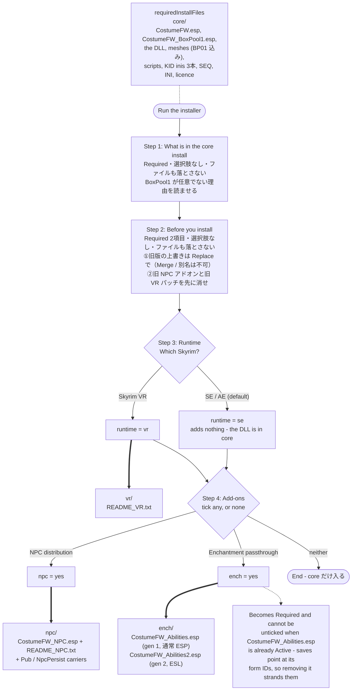

# FOMOD インストーラのフロー（1.6.4）

隣の `ModuleConfig.xml` から起こしたもの。**XML を変えたらここも直すこと。**

このファイルは配布物に入らない。`tools/package_fomod.ps1` は `fomod/` から
`info.xml` と `ModuleConfig.xml` だけを明示的にコピーする。意図的なので、
「README が抜けている」と思って追加しないこと。

FOMOD の構造は **質問がフラグを立て、フラグがフォルダを選ぶ** の2段。ただし
`core` だけは質問にぶら下がっておらず `requiredInstallFiles` にある＝**何も選ばず
決定を押しても 1.6.4 は入る**。図の太い矢印（`==>`）が条件つきでファイルを落とす
経路で、**3本**（＝`conditionalFileInstalls` の pattern が3つ）。

ファイルの出どころ（`core` は無条件、残りは `conditionalFileInstalls` の3 pattern）:

| 条件 | 落ちるもの | priority |
|---|---|---|
| なし（`requiredInstallFiles`） | `core` フォルダ | 0 |
| `runtime = vr` | `vr` フォルダ | 1 |
| `npc = yes` | `npc` フォルダ | 2 |
| `ench = yes` | `ench` フォルダ（gen 1 ＋ gen 2） | 2 |

## 読むときの要点

**`requiredInstallFiles` に `core` がある。** 何も考えずに決定を押し続けた人に
1.6.4 がそのまま入るのが正しい、という判断（2026-09-18）。1.6.3 までは空で、
`core` すら `proceed = yes` にぶら下がっていた。**「止まれ」の分岐があったから**で、
埋めると止めた人にも mod が乗ってしまうためだった。その分岐は消したので前提も消えた。

**中止の分岐を消した理由。** FOMOD に中止の概念は無く、できるのは「動かないものを
入れる」ところまで。つまり止めたい人ほど **mod マネージャの "Replace" で旧版を消す**
危険に近づく。守ろうとしていたのは *セーブに既に付いてしまった* 付呪の残りカスで、
インストーラを止めても消えない。⇒ **分岐を消し、警告文だけ Step 2 の Required 項目に
移した**（`install_canceled.txt` は削除。`git log -- package_assets/install_canceled.txt`）。

**Step 1 はファイルを落とさない。** 1.6.4 で増えたこのステップは `Required` の
項目が1つあるだけで、フラグも立てず条件にも使われない。**`CostumeFW_BoxPool1.esp`
が任意でない理由**（1スロットに複数 BOX の実体であること、ESL で枠を食わないこと、
**箱を作った後に外すとその箱が dormant になること**）を、選ぶ前に読ませるためだけの枠。
`KnownPoolMissing` の dormant 保持は**削除したときの保護であって選択肢ではない**ので、
オプション化しない。

**SE を選んでも何も増えない。** DLL は `core` に1本で SE / AE / VR 共通
（`REL::Module::IsVR()` で分岐する CommonLibSSE-NG の1バイナリ）。
それでも質問を残しているのは、**VR ユーザーに SkyrimVRESL と ImGui VR Helper を
伝える場所がここしかない**から。SE で入れて後から VR に移った人が、
提示されなかったファイルを欠く状態にもならない。XML 側の該当 pattern の上に
同じ趣旨のコメントがある（「there is no "se" pattern, and that is not an omission」）。

**更新は "Replace" が正解で、Merge と別名インストールは壊す。** キャリア NIF は
mod フォルダ内にビルドされ、隣に `<key>_carrier.hash` が置かれる。スキップ条件は
`hash ファイルが在る ＋ NIF が在る ＋ ハッシュ一致`（`NifCarrierCore.cpp:2651`）で、
**ハッシュの中身は入力（衣装 NIF の path+size+mtime）であって出力ではない**。
Merge や別名インストールは**古い `.hash` を残したまま 234B のプレースホルダ NIF を
被せる**ので、一致してスキップ → その箱は物理なしのまま黙って戻る。Replace は
両方まとめて消えるので次回起動でリビルドされる。`.hash` は配布物に入らない（実測 0 件）。

**インストーラにできないことと、DLL が受け持つことは違う。** FOMOD はセーブを読めず、
以前どの版が入っていたかも分からず（`CostumeFW.esp` はどの版にもある）、何を着ているかも
見えない。⇒ **Step 2 は検出ではなく通知**。DLL 側も「門番」ではなく**報告者**で、
1.6.3 以前のセーブを読んだときに旧機構が乗せていたであろう値を積算して表示し、
`cef abilities legacy` で再表示する（`AbilityPool.cpp:1408 ReportLegacySave`）。
⚠️ 2026-09-18 まで、この README と XML のコメントは「DLL がトークンを外すまで新機構を
始めない」と書いていたが、**そのゲートはコードに無い**。

**破線1本はファイルを動かさない。** 既に付呪 ESP を使っている人からチェックボックスを
取り上げる条件（`fileDependency file="CostumeFW_Abilities.esp" state="Active"` → `Required`）。
MO2 実機で確認済み（2026-09-14）。

## 検証済みの経路

| ケース | 結果 | いつ |
|---|---|---|
| ~~Stop を選ぶ~~ | 分岐ごと削除（2026-09-18）。**再検証が要る**: 決定を押し続けるだけで `core` が入ること | 要実施 |
| SE ＋ NPC ＋ 付呪 | esp 3本 ＋ SE の DLL。README_VR.txt は入らない | 2026-09-14（1.6.3） |
| 付呪 ESP が有効な状態で再インストール | Enchantment passthrough が Required になり外せない | 2026-09-14（1.6.3） |
| 生成物の中身（`dist/CostumeExpansionFW-1.6.4-FOMOD.7z` を直接一覧） | `core` に `CostumeFW.esp` ＋ `CostumeFW_BoxPool1.esp` ＋ KID ini 3本 ＋ DLL(3,351,040) ＋ pex/psc ＋ SEQ ＋ INI、`npc` に `CostumeFW_NPC.esp` ＋ `README_NPC.txt`、`ench` に gen 1 のみ、`vr` に `README_VR.txt` のみ | 2026-09-18（1.6.4・**中止分岐の削除前**） |
| `npc/CostumeFW_NPC.esp` の同一性 | `dist` の NPC-Addon 1.6.0 / 1.6.1 / FOMOD / `package_assets` が **md5 `ea1b4f6c…` で byte 一致**＝旧アドオンから乗り換えても binding が生きる | 2026-09-18 |

## 既知のズレ（XML 側の要修正）

- ~~`ModuleConfig.xml` の VR オプション説明に「once the MCM is gone in 1.6.4」が残っている~~
  → **2026-09-18 修正済み。**版番号を名指しせず、「SkyUI VR だけだと MCM になり、MCM は
  NPC 配布 / Blocked / Recovery / 箱の改名 / 2 箱以上ある slot に届かない」に置き換えた。
  ⚠️ **`dist/CostumeExpansionFW-1.6.4-FOMOD.7z` は修正前の XML で作られている**ので、
  アップロード前に `package_fomod.ps1` を回し直すこと。
- ~~`Enchantment passthrough` の説明が名指しする `CostumeFW_Abilities2.esp` が
  同梱されていない~~ → **2026-09-18 同梱済み**（`ench/` に gen 1 ＋ gen 2、
  SPEL 数と ESL フラグを `package_fomod.ps1` が検証する）。
- 満杯時の案内は `NextPoolPluginName()` が作るので、gen 2 まで埋まると今度は
  **`CostumeFW_Abilities3.esp`**（未配布）を名指しする。到達は 3,072 本先なので
  1.6.4 では放置。文面を「作者に連絡」に倒すなら C++ 側。
- 中止分岐の削除に伴い、`install_canceled.txt` を前提にした外部文面が残っている:
  `cef_documents/nexus/nexus_1.6.3_faq.txt`（公開済みの 1.6.3 FAQ）。
